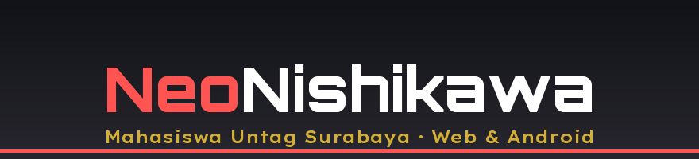

---

## Tentang saya

Aku seorang Mahasiswa di Universitas 17 Agustus 1945 Surabaya, dan juga seorang web developer. 
Fokus aku: membangun apa yang kuinginkan

Sedang mengerjakan **[SoraNema](https://github.com/NeoNishikawa/SoraNema)** — pelacak anime pribadi versi web dan Android.

---

## Tech Stack

  
  
  
  
  
  
  
  

Dominan `JavaScript` dan `PHP`, didukung `HTML/CSS` untuk tampilan, `Kotlin` untuk aplikasi Android, dan `Rust` untuk alat bantu CLI.

---

## Proyek

| Proyek | Deskripsi | Tautan |
|---|---|---|
| **SoraNema** | Pelacak anime pribadi — aplikasi web dulu, sekarang web + Android APK. Katalog, detail, episode, dan progres menonton tersimpan di perangkat sendiri. | [SoraNema](https://github.com/NeoNishikawa/SoraNema) |
| **iLovenimeV2.9** | Web tracker anime berbasis Node.js; katalog, detail, dan mirror untuk menonton anime di browser. | [iLovenimeV2.9](https://github.com/NeoNishikawa/iLovenimeV2.9) |
| **Pertanian-Design** | Desain halaman pertanian — eksperimen layout buku pertanian dan tata letak web. | [Pertanian-Design](https://github.com/NeoNishikawa/Pertanian-Design) |
| **Article** | Landing page personal/berisi konten tulisan. | [Article](https://github.com/NeoNishikawa/Article) |
| **western** | Template website statis dengan gaya western/kafe. | [western](https://github.com/NeoNishikawa/western) |

---

## GitHub Stats

   
   
  

